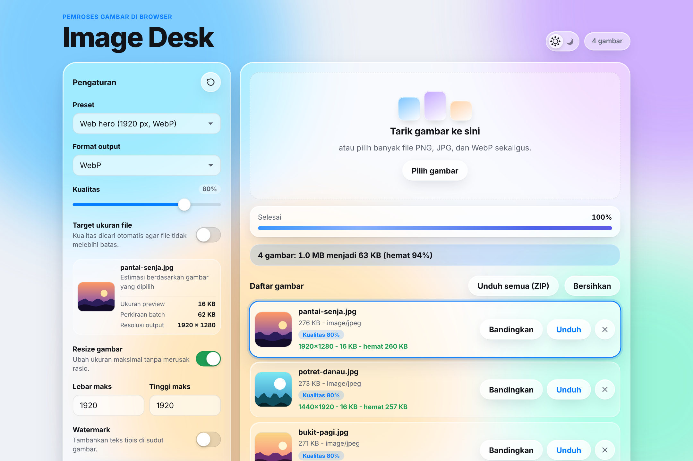
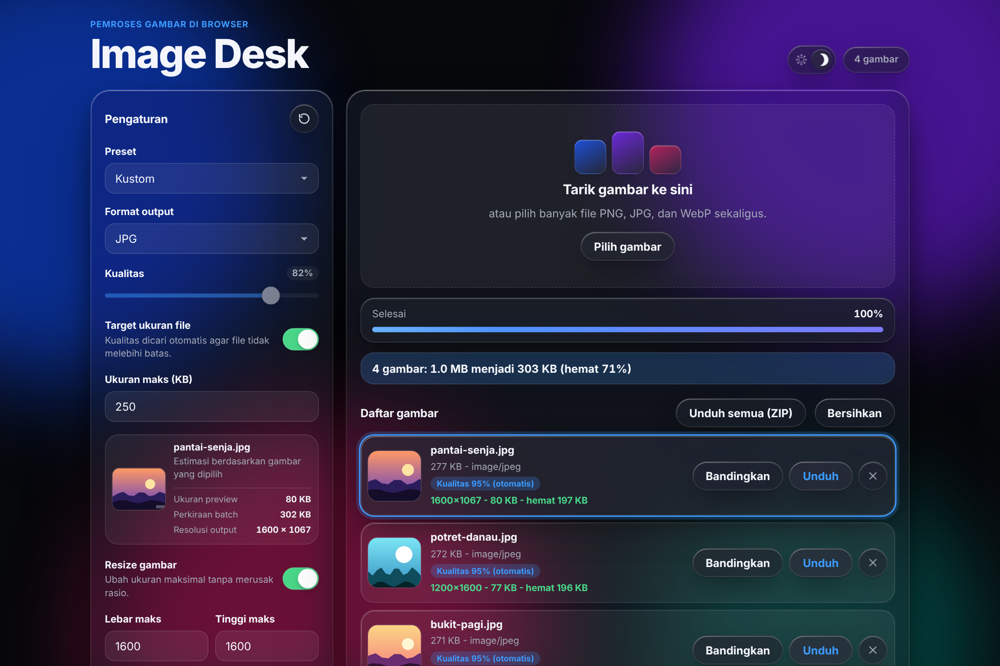
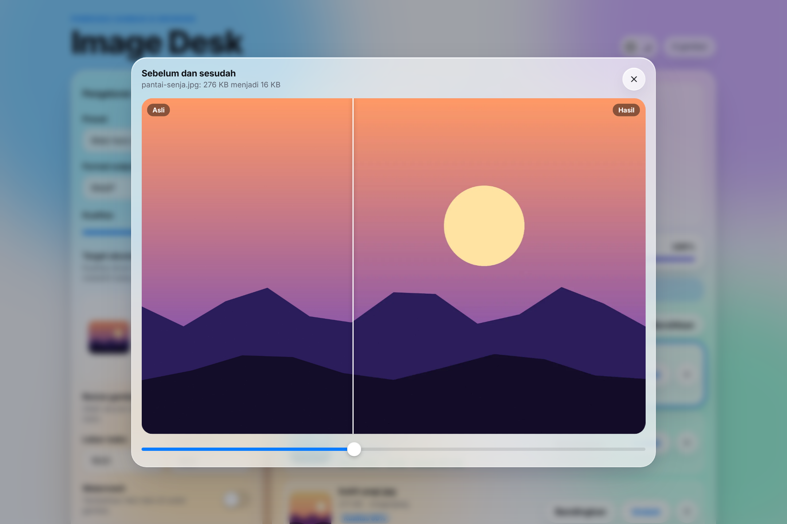
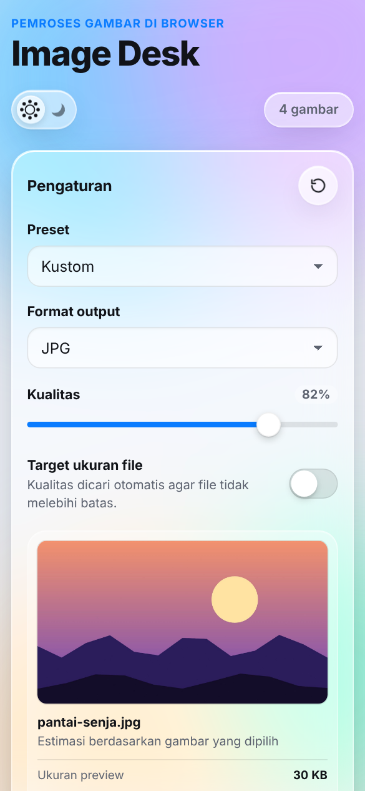

<h1 align="center">Image Desk</h1>

<p align="center">Pemroses gambar berbasis browser: kompres, ubah ukuran, konversi format, dan beri watermark secara massal, tanpa mengunggah apa pun ke server.</p>

<p align="center">
  
  
  
  
</p>

<p align="center">
  <a href="#tampilan">Tampilan</a> ·
  <a href="#fitur">Fitur</a> ·
  <a href="#menjalankan">Menjalankan</a> ·
  <a href="#cara-penggunaan">Penggunaan</a> ·
  <a href="#preset">Preset</a> ·
  <a href="#dukungan-browser">Browser</a> ·
  <a href="#struktur">Struktur</a>
</p>

<p align="center">
  
</p>

---

## Ringkasan

Image Desk memproses banyak gambar sekaligus langsung di browser. Setiap gambar digambar ulang pada kanvas lalu diekspor ke format pilihan, sehingga tidak ada berkas yang dikirim ke server. Cocok untuk menyiapkan foto sebelum diunggah ke situs, marketplace, media sosial, atau formulir yang membatasi ukuran file.

Antarmukanya bergaya *liquid glass*: panel kaca tembus pandang dengan blur, sakelar dan slider ala iOS, serta animasi pegas yang halus. Tersedia tema terang dan gelap.

## Tampilan

<table>
  <tr>
    <td width="50%"></td>
    <td width="50%"></td>
  </tr>
  <tr>
    <td align="center"><sub><b>Tema gelap</b> dengan target ukuran file. Kualitas dipilih otomatis per gambar.</sub></td>
    <td align="center"><sub><b>Perbandingan sebelum/sesudah.</b> Geser pembatas untuk menilai hasil kompresi.</sub></td>
  </tr>
</table>

<p align="center">
  <br />
  <sub><b>Tampilan ponsel.</b> Tata letak satu kolom yang nyaman disentuh.</sub>
</p>

## Fitur

**Pemrosesan**

- **Konversi format** ke JPG, WebP, atau PNG.
- **Kompresi dengan slider kualitas** (10–100%), beserta pratinjau ukuran dan resolusi hasil.
- **Ubah ukuran** berdasarkan lebar dan tinggi maksimum. Rasio asli dipertahankan dan gambar tidak pernah diperbesar.
- **Target ukuran file** (mis. maks 200 KB). Kualitas tertinggi yang masih di bawah batas dicari otomatis untuk JPG dan WebP.
- **Preset sekali klik** untuk Instagram, WhatsApp, web, thumbnail, dan email.
- **Watermark teks** dengan pilihan posisi (empat sudut atau tengah) dan transparansi.

**Alur kerja**

- **Pemrosesan batch** dengan kualitas yang bisa diatur per gambar.
- **Seret dan lepas** berkas ke area unggah, atau pilih banyak berkas sekaligus.
- **Hapus per gambar** dan **ringkasan total penghematan** setelah proses selesai.
- **Unduh semua sebagai satu file ZIP** (tanpa library tambahan), atau unduh satu per satu.
- **Perbandingan sebelum/sesudah** dengan slider geser.
- **Peringatan otomatis** jika hasil lebih besar dari file asli, atau jika browser tidak mendukung format pilihan.

**Tampilan dan aksesibilitas**

- Tema terang dan gelap mengikuti pengaturan sistem, bisa diganti manual, dan tidak berkedip saat halaman dimuat.
- Fokus keyboard terlihat jelas, dan animasi otomatis dimatikan jika sistem diatur ke *kurangi gerakan*.

## Menjalankan

Tidak memerlukan Node.js, dependensi, maupun proses build. Sajikan folder ini melalui server HTTP statis:

```sh
python -m http.server 8080
```

Lalu buka `http://localhost:8080`.

Untuk publikasi, folder root dapat langsung dipakai pada **GitHub Pages**: *Settings → Pages → Deploy from a branch → `main` / root*.

## Cara penggunaan

1. **Tambahkan gambar.** Seret ke area unggah, atau klik **Pilih gambar**. Format yang didukung: PNG, JPG, dan WebP.
2. **Pilih preset atau atur manual.** Tentukan format output, kualitas, ukuran maksimum, dan watermark di panel **Pengaturan**. Klik sebuah gambar di daftar untuk mengatur kualitasnya sendiri.
3. **(Opsional) Aktifkan Target ukuran file** dan isi batasnya dalam KB. Slider kualitas akan dikunci karena kualitas dicari otomatis.
4. **Klik Proses gambar.** Setiap item menampilkan resolusi, ukuran, dan penghematannya.
5. **Periksa hasil** dengan **Bandingkan**, lalu **Unduh** satu per satu atau **Unduh semua (ZIP)**.

Nama file hasil mengikuti pola `nama-asli-<lebar>w.<ekstensi>`, misalnya `pantai-senja-1920w.webp`.

## Preset

| Preset | Format | Kualitas | Ukuran maks |
| --- | --- | --- | --- |
| Instagram | JPG | 85% | 1080 × 1350 px |
| WhatsApp | JPG | 75% | 1600 × 1600 px |
| Web hero | WebP | 80% | 1920 × 1920 px |
| Thumbnail | WebP | 75% | 400 × 400 px |
| Email ringan | JPG | 70% | 1280 × 1280 px |

Mengubah format atau ukuran secara manual otomatis mengembalikan preset ke **Kustom**.

## Dukungan browser

| Browser | Status |
| --- | --- |
| Chrome / Edge (versi terbaru) | Didukung penuh dan sudah diuji |
| Firefox (versi terbaru) | Seharusnya didukung, tetapi belum diuji langsung |
| Safari (macOS / iOS) | Seharusnya didukung, tetapi belum diuji langsung. Efek kaca memakai `-webkit-backdrop-filter`. Jika browser tidak bisa mengekspor WebP, hasilnya disimpan sebagai PNG dan ditandai di daftar. |

Pada browser tanpa `backdrop-filter`, panel memakai latar kaca yang lebih pekat agar tetap mudah dibaca.

## Privasi

- Seluruh pemrosesan terjadi di perangkat pengguna. Berkas tidak dikirim ke server mana pun.
- Karena gambar digambar ulang pada kanvas, metadata EXIF (termasuk lokasi GPS) tidak ikut tersimpan pada file hasil.

## Struktur

```text
index.html          Antarmuka
script.js           Logika pemrosesan gambar, ZIP, dan perbandingan
styles.css          Gaya liquid glass, tema, dan animasi
docs/screenshots/   Tangkapan layar untuk README
```

## Catatan pengembangan

- Belum ada suite pengujian otomatis.
- Fitur preset, target ukuran file, unduhan ZIP, perbandingan, dan hapus per gambar sudah diperiksa di Chromium headless tanpa error JavaScript (24 November 2026). File ZIP hasil unduhan lolos `unzip -t`.
